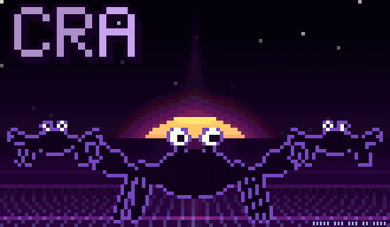

# crab-rave

```sh
cargo install --git https://github.com/yannelli/crab-rave
crab-rave --sound
```

Run it before you read anything else. Turn the volume up. Make the window as big as it goes.

<p align="center">
  
</p>

The GIF has no sound. Use `--sound` for the full experience.

## What is this

A 1,650-line Rust program that draws a crab rave in your terminal. Every crab is drawn from scratch, every frame, from jointed arms, snapping pincers, and eyes that look around. The music is synthesized sample by sample while you watch. There are no image files, no audio files, and no game engine.

The crabs know four routines. You can find out what they are by watching.

## Install

```sh
cargo install --git https://github.com/yannelli/crab-rave
```

You need Rust 1.88 or newer. On Linux, install the ALSA development package first (`libasound2-dev` on Debian and Ubuntu, `alsa-lib-devel` on Fedora).

## Usage

```sh
crab-rave           # rave until you press a key
crab-rave --sound   # rave with the beat
crab-rave -d 30     # rave for 30 seconds
crab-rave --help
```

## Terminals

crab-rave looks best in terminals with 24-bit color, such as Ghostty, iTerm2, WezTerm, and Kitty. Other terminals get 256 colors. A bigger window gets a bigger crab. The banner needs at least 55 columns.

iTerm2 users get something extra. Look at your tab.

## Make it better

The crabs want more. Pull requests are welcome, from one-line fixes to new scenes. Some ideas:

- **New dance routines.** Poses live in `src/crab.rs`. A routine is a list of arm positions per beat. The crabs have never done the worm.
- **More crabs.** A crab line, a crab conga, a crab that crowd-surfs across the screen.
- **Better music.** The synth in `src/audio.rs` is about 230 lines. Write a new section, a breakdown, a second drop, or a better bassline. Keep it original.
- **New scenes.** The stage in `src/scene.rs` is a synthwave sunset. It could be an underwater club, a beach at night, or a disco ball.
- **Terminal tricks.** The Kitty graphics protocol, Ghostty features, sixel, or anything else a terminal can do.
- **Windows support.** It might work. Nobody has checked.
- **Smaller binary and faster frames.** Measure first, then make it faster.

To work on it:

```sh
git clone https://github.com/yannelli/crab-rave
cd crab-rave
cargo run --release -- --sound
```

Before you open a pull request, run `cargo fmt` and `cargo clippy -- -D warnings`. Add a GIF or screenshot when the change is visible. Open an issue first if you want to talk about a big idea.

## How it works

| File | What it does |
| --- | --- |
| `src/main.rs` | Arguments, terminal setup, and the 30 fps frame loop |
| `src/canvas.rs` | A pixel canvas drawn with half-block characters, two pixels per cell |
| `src/crab.rs` | The procedural crab and its dance poses |
| `src/scene.rs` | The stage: sky, sun, floor grid, light beams, shockwaves, confetti, and the drop |
| `src/audio.rs` | The synthesizer: kick, claps, hats, bass, pad, and arpeggio at 125 BPM |
| `src/art.rs` | The banner font |

The picture and the music follow the same 125 BPM timeline, so each kick lands with its shockwave.

## License

MIT
